<div align="center">


# Умный дневник

**Электронный дневник, который помогает учиться, а не просто показывает оценки.**

ИИ-тесты · закрытие долгов · умная рассадка · огонёк с маскотами предметов — прямо в мессенджере MAX

<br />


[](https://sovolud.ru)
[](https://max.ru/ideya_fiks_91_bot)

[Демо](#-демо) · [Быстрый старт](#-быстрый-старт) · [Возможности](#-возможности) · [Архитектура](#-архитектура) · [Документация](#-проектная-документация)

<br />

*Хакатонный MVP команды «Совёнки» 🦉*

</div>


---

## Проблема и идея
## 📑 Содержание


- [Зачем это нужно](#-зачем-это-нужно)
- [Демо](#-демо)
- [Возможности](#-возможности)
- [Быстрый старт](#-быстрый-старт)
- [Демо-вход для жюри](#-демо-вход-для-жюри)
- [Архитектура](#-архитектура)
- [Проектная документация](#-проектная-документация)
- [Технологический стек](#-технологический-стек)
- [Структура репозитория](#-структура-репозитория)
- [Безопасность](#-безопасность)
- [Команда](#-команда)

---

## 💡 Зачем это нужно

Школьный электронный журнал показывает оценки, но не помогает **учиться** и **преподавать**.

| 👩‍🏫 Учитель | 🧒 Ученик |
|---|---|
| Тратит часы на тесты и рассадку| Не видит, что именно нужно «доучить» |
| Не видит пробелы класса по темам и не знает, по каким проблемным темам нужно подготовить разборы | Долги копятся и теряются |
| Данные живут в ЕРИСО КО и Excel-выгрузках | Нет мотивации делать ДЗ регулярно |

**Умный дневник** берёт выгрузку журнала и превращает её в живой инструмент:

- 🧠 **ИИ находит слабые темы класса** и подсказывает, что разобрать на следующем уроке.
- 📝 **Тест по теме за минуту:** сгенерировать, поправить, опубликовать.
- 🎯 **Долги больше не теряются.** Ученик видит их списком и может готовиться к пересдачее.
- 🔥 **Огонёк и маскот предмета** мотивируют делать ДЗ каждый день.

---

## 🎬 Демо

<div align="center">
  <table>
    <tr>
      <th width="50%">👨‍🏫 <b>Учитель</b></th>
      <th width="50%">🎓 <b>Ученик</b></th>
    </tr>
    <tr>
      <td align="center" valign="top">
        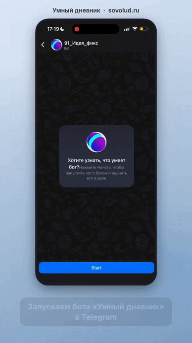
        <br>
        <sub>Аналитика класса → рассадка → ИИ-тест</sub>
      </td>
      <td align="center" valign="top">
        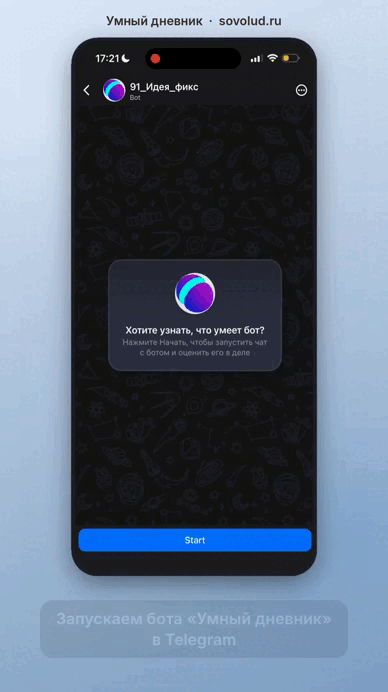
        <br>
        <sub>Тест → разбор ошибок → долги → огонёк</sub>
      </td>
    </tr>
  </table>
</div>

### 🚀 Попробуйте сейчас

Ставить ничего не нужно, проект уже работает:

| Где | Ссылка |
|---|---|
| 🌐 В браузере | **[sovolud.ru](https://sovolud.ru)** |
| 💬 В мессенджере MAX | **[@ideya_fiks_91_bot](https://max.ru/ideya_fiks_91_bot)** |

На стартовой странице выберите **«Учитель»** или **«Ученик»**. Подробности о входе ниже, в разделе [Демо-вход для жюри](#-демо-вход-для-жюри).

### Сквозной сценарий (5 минут)

1. **Учитель** → дашборд → класс 7А → **аналитика**: слабая тема и рекомендация ИИ.
2. **Рассадка** → «Сгенерировать» → при желании вручную поменяйте ее с помощью перемещения карточек → **скачайте PNG**.
3. **Тесты** → «Создать» → тема → «Сгенерировать ИИ» → правка → публикация.
4. **Ученик** → «Тесты» → пройдите тест → **разбор ошибок**.
5. «Мои задолженности» → тренировочный тест по долгу.
6. **Огонёк и маскот** предмета: в правом верхнем углу нажмите на иконку огня с цифрой → **рейтинг классов**.

---

## Возможности

### Учитель
- **Вход через MAX** — без паролей, по  `initData`
- **Дашборд классов** — средний балл, горящие долги, «проблемные» классы подсвечиваются автоматически (ср. балл < 3.5 или > 3 долгов)
- **Электронный журнал** класса с пагинацией
- **Импорт Excel-выгрузки ЕРИСО КО** — оценки, уроки, темы, ДЗ (парсер)
- **Аналитика класса** — распределение оценок, выявление проблемных тем и **ИИ-рекомендация** к следующему уроку
- **Умная рассадка** — генерация с учётом маркеров, возможность ручной/самостоятельной настройки,  **экспорт в PNG**, загрузка фото класса
- **ИИ-тесты** — генерация по теме → проверка и редактирование → публикация; ручное создание

### Ученик
- **Тесты**  частичные баллы, порог сдачи 70 %
- **Разбор ошибок** с ИИ-объяснением после сдачи
- **«Мои задолженности»** → тренировочный тест по теме долга
- **Серия ДЗ «Огонёк»** 🔥 и **маскот предмета** — у каждого предмета свой "Соволудь"
- **Отчёт по предмету** — средний балл и процент выполненных ДЗ
- **Рейтинг классов** параллели (КР/ВПР)

### 🦉 Маскоты предметов

У каждого предмета свой персонаж. Он живёт рядом с «огоньком» и поддерживает ученика.

<p align="center">
  
  
  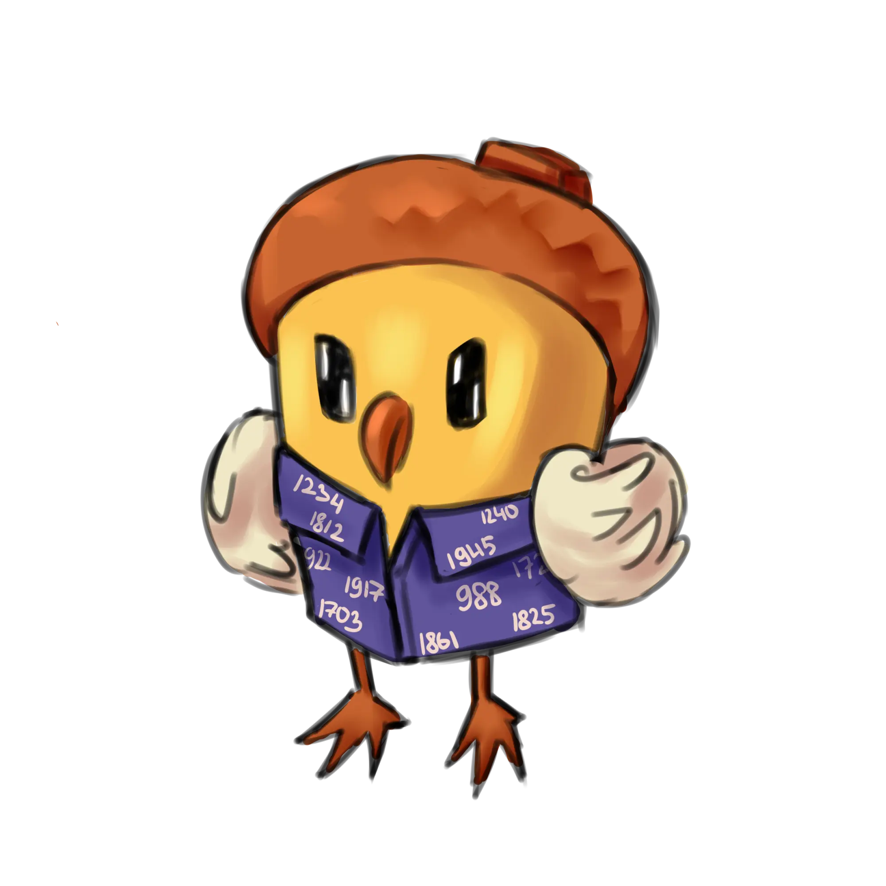
  
  
  
  <br />
  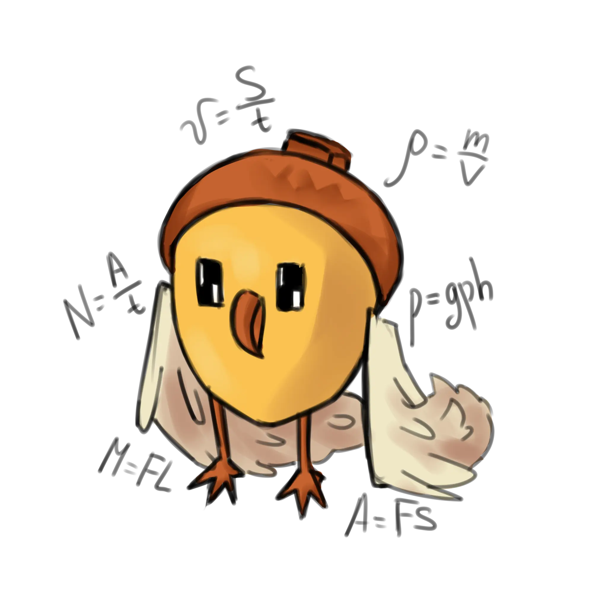
  
  
  
  
  
</p>

---


## Быстрый старт

Хотите просто посмотреть? Откройте **[sovolud.ru](https://sovolud.ru)**. Хотите запустить у себя: нужны только **Docker** и **Docker Compose**.

```bash
# 1. Склонируйте репозиторий
git clone https://github.com/tortikghst/Smart-Diary.git smart-diary && cd smart-diary

# 2. Создайте конфиг (мок-ИИ включён, ключи не нужны)
cp .env.example backend/.env

# 3. Поднимите всё
docker compose up --build
```

После запуска доступно:

| Сервис | Адрес |
|---|---|
| 🖥️ Приложение (frontend) | http://localhost |
| 📡 Swagger / OpenAPI | http://localhost:8080/docs |
| 🗄️ pgAdmin | http://localhost:5050 |
| 🐘 PostgreSQL | `localhost:5433` |
| ⚡ Redis | `localhost:6378` |

### 🔑 Демо-вход для жюри


«Умный дневник» — закрытая платформа: в боевом режиме вход разрешён только ученикам и учителям конкретной школы через MAX. Чтобы жюри могло проверить проект без школьных аккаунтов, на живом стенде [sovolud.ru](https://sovolud.ru) вход через MAX отключён, а на стартовой странице работают две кнопки: **«Ученик»** и **«Учитель»**. Они входят под демо-профилями с тестовыми данными.

> Реальных персональных данных на демо-стенде нет. Авторизация через MAX (`initData`, подпись HMAC-SHA256) реализована в коде и включается в конфигурации.

| Роль | Кто | Что посмотреть |
|---|---|---|
| 👩‍🏫 Учитель | Иванов Иван Иванович (математика, `vk_id=12345`) | классы 7А–9Б, журнал, аналитика, рассадка, создание ИИ-теста |
| 🧒 Ученик | первый ученик 7А (`vk_id=23456`) | долги, тесты, огонёк, маскот, рейтинг |

---

## Архитектура

<p align="center">
  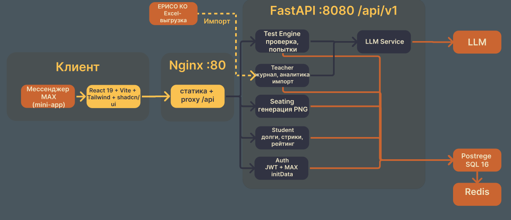
</p>

### Поток прохождения теста

<p align="center">
  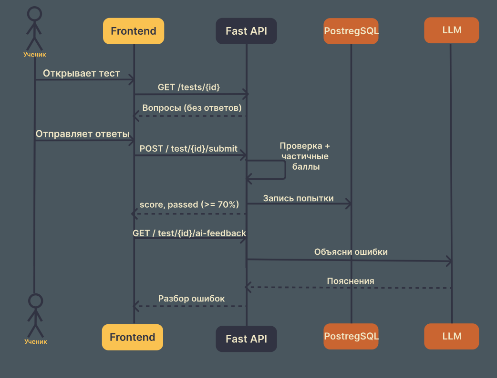
</p>


> Правильные ответы **никогда не отдаются** клиенту до сдачи теста — списать через DevTools нельзя.

---

## Проектная документация

> 🔒 Правильные ответы **никогда не отдаются** клиенту до сдачи теста, поэтому списать через DevTools нельзя.

---

## 📚 Проектная документация
>>>>>>> 731874fcc9f32373ad7d7c8be720a08035fb9b09


<details>
<summary>👉 <b><ins>Use case</ins></b> — роли и сценарии, где участвует ИИ <i>(нажмите, чтобы раскрыть)</i></summary>

<p align="center">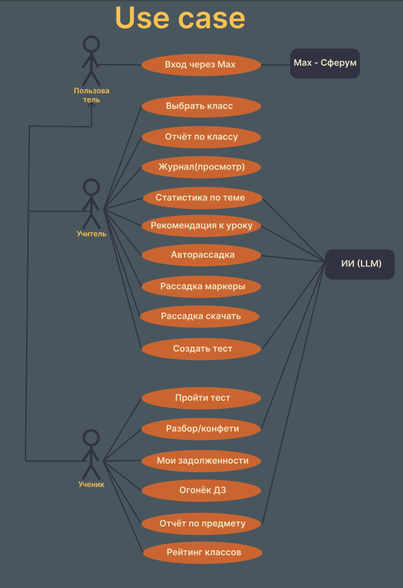</p>

</details>

<details>
<summary>👉 <b><ins>User flow ученика</ins></b> — пять ключевых сценариев <i>(нажмите, чтобы раскрыть)</i></summary>

<p align="center">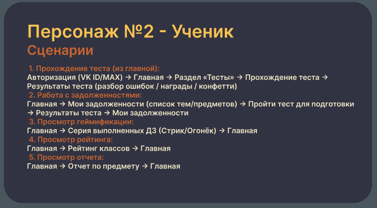</p>

</details>

<details>
<summary>👉 <b><ins>User flow учителя</ins></b> — пять ключевых сценариев <i>(нажмите, чтобы раскрыть)</i></summary>

<p align="center">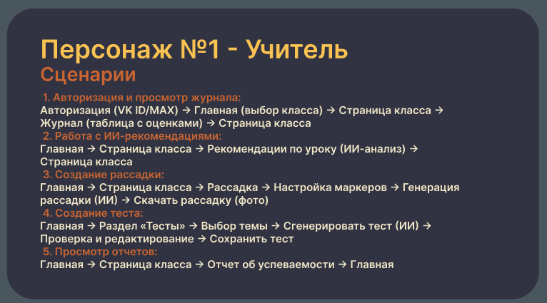</p>

</details>

<details>
<summary>👉 <b><ins>Site map ученика</ins></b> — карта экранов <i>(нажмите, чтобы раскрыть)</i></summary>

<p align="center">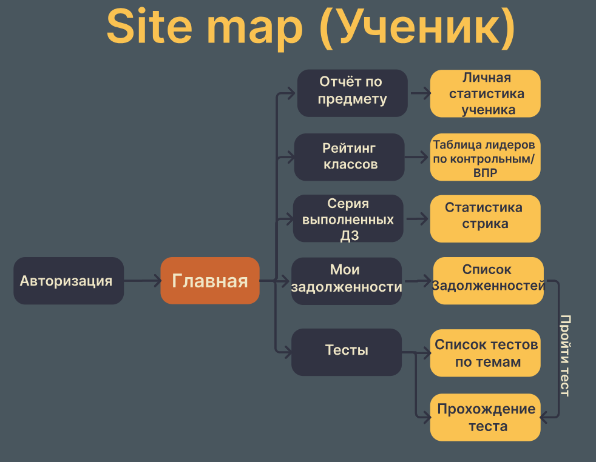</p>

</details>

<details>
<summary>👉 <b><ins>Site map учителя</ins></b> — карта экранов <i>(нажмите, чтобы раскрыть)</i></summary>

<p align="center">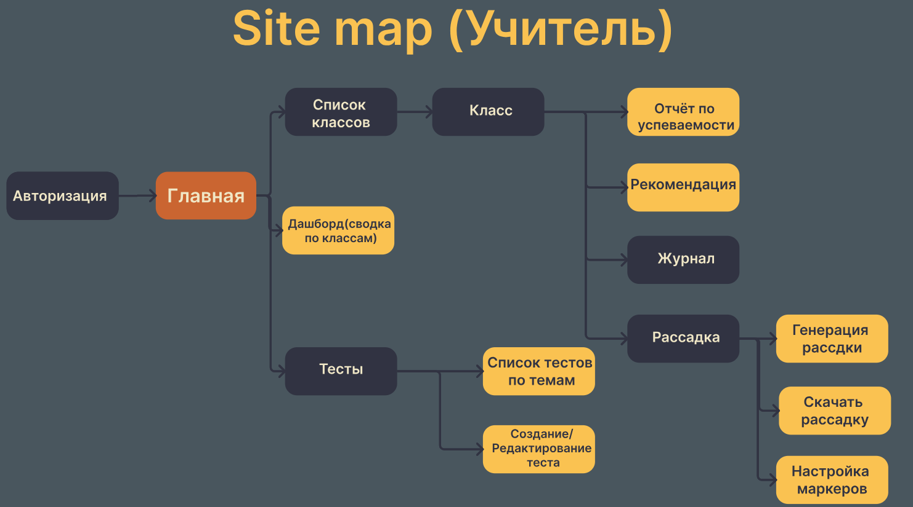</p>

</details>

<details>
<summary>👉 <b><ins>Логика проверки тестов</ins></b> — как начисляются баллы <i>(нажмите, чтобы раскрыть)</i></summary>

<p align="center">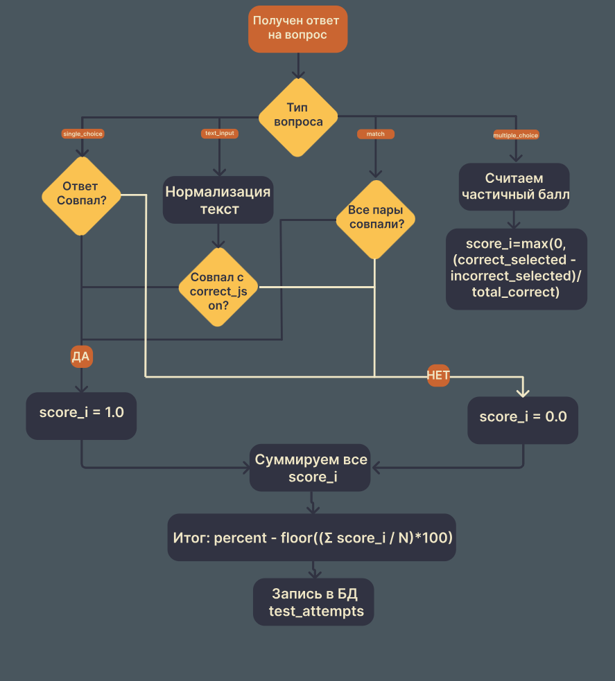</p>

Для каждого вопроса считается `score_i ∈ [0; 1]`, итог: `percent = floor(Σ score_i / N · 100)`.
Для множественного выбора частичный балл считается так: `max(0, (верных − неверных) / всего_верных)`. Результат пишется в `test_attempts`.

</details>

<details>
<summary>👉 <b><ins>Автоматическое закрытие долгов</ins></b> — как долги закрываются сами <i>(нажмите, чтобы раскрыть)</i></summary>

<p align="center">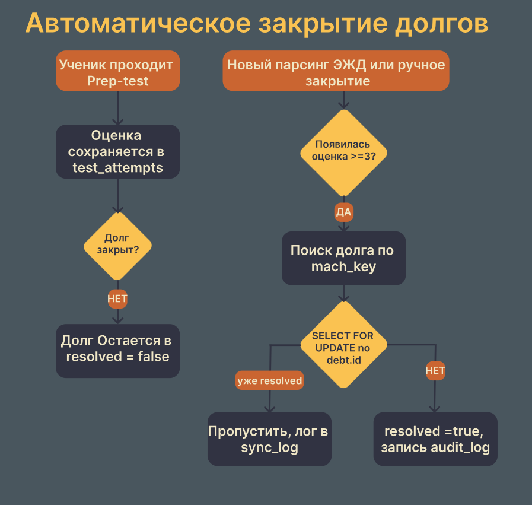</p>

Долг закрывается, когда в новой выгрузке ЕРИСО КО появляется оценка ≥ 3, либо вручную учителем. Операция идемпотентна (`SELECT … FOR UPDATE`), каждое действие пишется в `audit_log` / `sync_log`.

</details>

<details>
<summary>👉 <b><ins>Сервисная карта</ins></b> — как связаны сервисы <i>(нажмите, чтобы раскрыть)</i></summary>

<p align="center">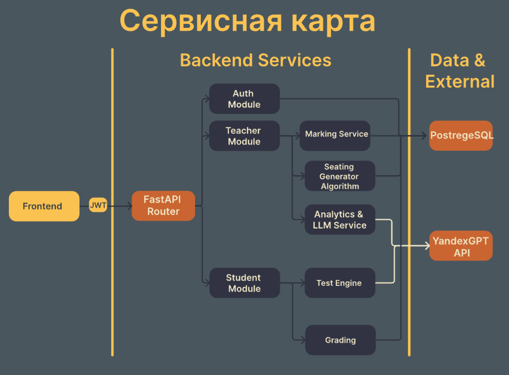</p>

</details>

---

## Технологический стек

| Слой | Технологии |
|---|---|
| **Backend** | Python 3.12, FastAPI, SQLAlchemy 2 (async) + asyncpg, Pydantic v2, python-jose (JWT), openpyxl, Pillow, httpx |
| **Frontend** | React 19, TypeScript, Vite, Tailwind CSS 4, shadcn/ui (Radix), Framer Motion, dnd-kit, React Router 7 |
| **Данные** | PostgreSQL 16, Redis |
| **ИИ** | Caila / OpenRouter (qwen), структурированный JSON-вывод, мок-режим |
| **Инфраструктура** | Docker Compose, Nginx, pgAdmin |
| **Интеграции** | MAX (авторизация `initData`, бот с webhook), ЕРИСО КО (Excel) |

## Структура репозитория
---

## 🗂️ Структура репозитория

```text
.
├── backend/                  # FastAPI-сервис → backend/README.md
│   └── scr/
│       ├── api/              # роутеры (auth, teacher, student, journal, tests, seating, bot)
│       ├── services/         # JWT, LLM, импорт ЕРИСО, PNG-рассадка
│       ├── repositories/     # работа с БД и бизнес-логика
│       ├── schemas/          # Pydantic-схемы
│       ├── model/            # SQLAlchemy-модели (21 таблица)
│       └── seed_big_demo.py  # демо-данные
├── frontend/smart-diary/     # React-приложение → frontend/smart-diary/README.md
├── docs/                     # схемы проекта и скринкасты
├── docker-compose.yml
└── .env.example
```

## Подробнее
**Подробнее:**
[📡 Backend README](backend/readme.md) · [🎨 Frontend README](frontend/smart-diary/README.md)

---

## Безопасность

- JWT (access 24 ч / refresh 30 дн) и роли `student` / `teacher` / `admin` (RBAC).
- Подпись `initData` проверяется по HMAC-SHA256 (алгоритм MAX Bridge).
- Учитель видит только **свои** классы.
- Правильные ответы тестов не уходят на клиент.
- Секреты хранятся только в `.env`, файл добавлен в `.gitignore`.

> **Демо-вход** (`initData` содержит `teacher`/`student`) включён для хакатона. Перед продом его необходимо отключить — см. [backend/README.md](backend/README.md#-безопасность-и-переход-в-прод).

## Команда «Совёнки»

> ⚠️ **Демо-вход** (`initData` содержит `teacher` / `student`) включён для хакатона. Перед продом его нужно отключить: см. [backend/README.md](backend/README.md#-безопасность-и-переход-в-прод).

---


## 🦉 Команда

<!-- TODO: добавьте участников и роли, например: -->
<!-- | Имя | Роль | -->
<!-- |---|---| -->
<!-- | … | Backend | -->
Проект создан на хакатоне **«Идея Фикс»** командой **«Совёнки»**.

<!-- Добавьте ссылки на участников, например: -->
<!-- [@tortikghst](https://github.com/tortikghst) -->

  <h3>📄 Презентация идеи с первого этапа</h3>
  <a href="docs/презентация идеи.pdf" target="_blank">
    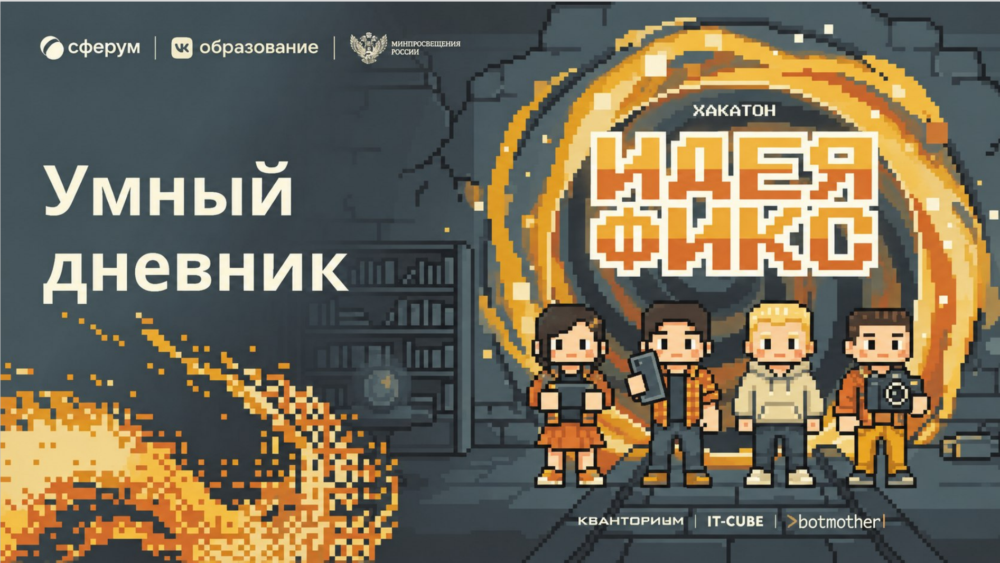
  </a>
  <br>
  <sub><i>(Нажмите на картинку, чтобы открыть PDF)</i></sub>
</div>
