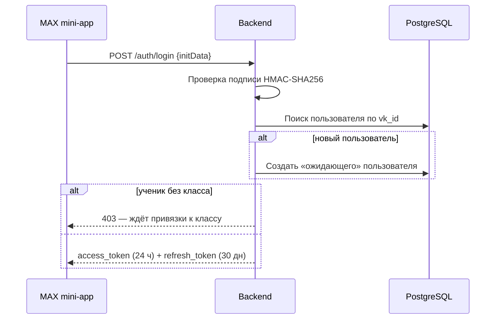
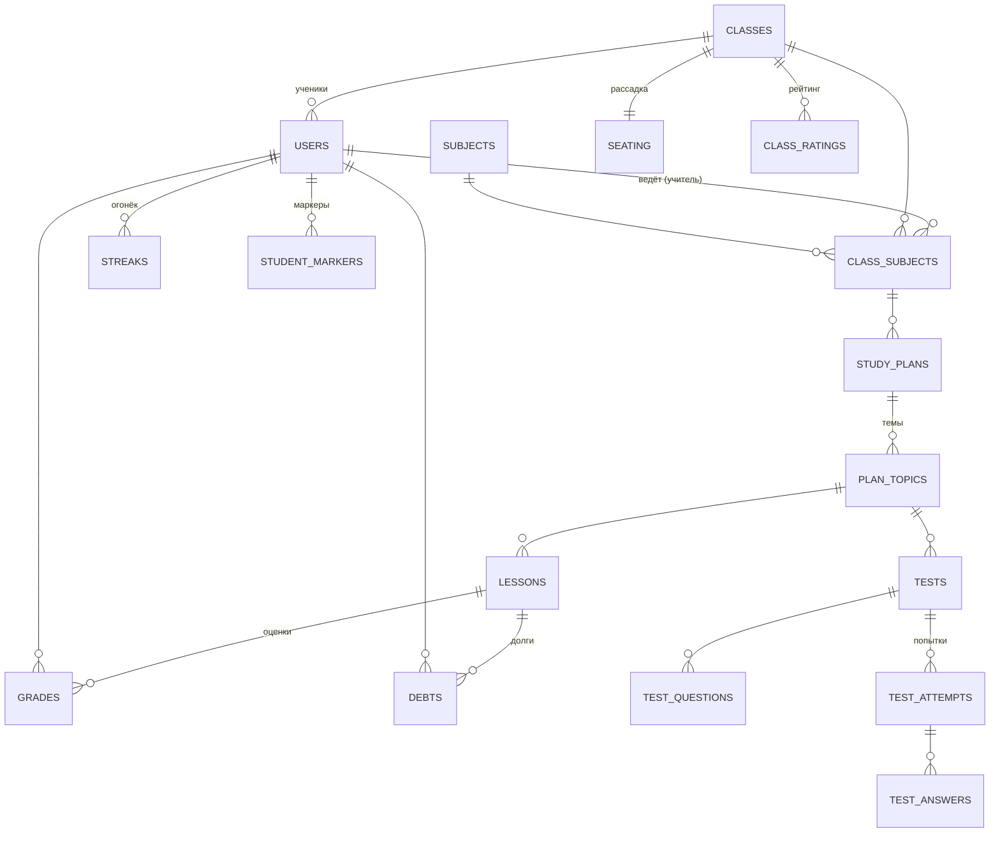

# 📡 Smart Diary — Backend

REST API «Умного дневника» на **FastAPI**: полностью асинхронный, единый префикс **`/api/v1`**, интерактивная документация на `/docs`.

← [Главный README](../README.md) · [Frontend](../frontend/smart-diary/README.md)

---

## 📑 Содержание

1. [Стек](#-стек)
2. [Запуск](#-запуск)
3. [Конфигурация](#-конфигурация-env)
4. [Структура](#-структура-проекта)
5. [Авторизация и роли](#-авторизация-и-роли)
6. [Справочник API](#-справочник-api)
7. [Модель данных](#-модель-данных)
8. [Бизнес-логика](#-ключевая-бизнес-логика)
9. [ИИ-модуль](#-ии-модуль)
10. [Демо-данные и тесты](#-демо-данные-и-тестирование)
11. [Безопасность и переход в прод](#-безопасность-и-переход-в-прод)
12. [Коды ошибок](#-коды-ошибок)

---

## 🧰 Стек

Python 3.12 · FastAPI · SQLAlchemy 2 (async) + asyncpg · Pydantic v2 / pydantic-settings · python-jose (JWT) · openpyxl (Excel) · Pillow (PNG рассадки) · python-magic (проверка типа файлов) · httpx · Redis · PostgreSQL 16

## 🚀 Запуск

### Через Docker Compose (рекомендуется)

Из **корня репозитория**:

```bash
cp .env.example backend/.env
docker compose up --build
```

API: http://localhost:8080 · Swagger: http://localhost:8080/docs

### Локально (без Docker)

Нужны запущенные PostgreSQL и Redis (можно поднять только их: `docker compose up postgres_db redis_container`).

```bash
cd backend
python -m venv .venv && source .venv/bin/activate      # Windows: .venv\Scripts\activate
pip install -r requirements.txt
# системная зависимость для python-magic:  apt install libmagic1  (macOS: brew install libmagic)

cp ../.env.example .env
# в .env: DB_HOST=127.0.0.1, DB_PORT=5433 (порт, проброшенный compose), REDIS_PORT=6378

uvicorn scr.main:app --host 0.0.0.0 --port 8080 --reload
```

> 💡 Имя пакета — `scr` , запускать нужно из папки `backend/`.

При старте приложение автоматически: создаёт таблицы (`create_all`, с 5 повторными попытками, пока БД не готова) и заливает демо-данные.

## ⚙️ Конфигурация (.env)

| Переменная | По умолчанию | Описание |
|---|---|---|
| `POSTGRES_USER/PASSWORD/DB` | — | Инициализация контейнера PostgreSQL |
| `DB_USER/PASSWORD/NAME` | — | Подключение приложения к БД |
| `DB_HOST` / `DB_PORT` | `127.0.0.1` / `5432` | В Docker compose подменяются на `postgres_db:5432` |
| `REDIS_HOST` / `REDIS_PORT` | `127.0.0.1` / `6379` | В Docker — `redis_container:6379` |
| `JWT_SECRET_KEY` | — (обязательно) | Секрет подписи JWT |
| `JWT_ALGORITHM` | `HS256` | |
| `ACCESS_TOKEN_EXPIRE_MINUTES` | `1440` | 24 часа |
| `REFRESH_TOKEN_EXPIRE_MINUTES` | `43200` | 30 дней |
| `USE_MOCK_LLM` | `True` | `True` — мок-ответы ИИ; `False` — реальные запросы |
| `LLM_API_KEY` | — | Ключ Caila (OpenRouter) |
| `LLM_MODEL` | `qwen/qwen3.7-flash` | Модель |
| `MAX_BOT_TOKEN` | mock | Токен бота MAX (и ключ проверки подписи `initData`) |
| `SCHOOL_TZ` | `Europe/Kirov` | Часовой пояс школы |

## 🗂️ Структура проекта

```
backend/
├── Dockerfile
├── requirements.txt
├── test_flow.py                 # сквозной E2E-скрипт (httpx)
└── scr/
    ├── main.py                  # приложение, CORS, lifespan (init_db + seed)
    ├── config.py                # настройки (pydantic-settings)
    ├── database.py              # async-движок, сессии, init_db
    ├── seed_big_demo.py         # большой демо-набор данных
    ├── api/                     # HTTP-слой
    │   ├── auth.py              #   /auth/login, /auth/refresh
    │   ├── users.py             #   /users/me
    │   ├── teacher.py           #   панель учителя, тесты, импорт, долги
    │   ├── journal.py           #   журнал и аналитика класса
    │   ├── student.py           #   панель ученика, маскот, prep-тест
    │   ├── tests.py             #   прохождение тестов, ИИ-разбор
    │   ├── seating.py           #   рассадка, PNG, фото класса
    │   ├── bot.py               #   webhook бота MAX
    │   └── auth_deps*.py        #   зависимости: RBAC, владелец класса
    ├── services/
    │   ├── jwt_service.py       #   JWT + проверка подписи MAX initData
    │   ├── llm_service.py       #   клиент LLM (Caila / OpenRouter)
    │   ├── eriso_adapter.py     #   адаптер ЕРИСО КО
    │   ├── journal_excel_service.py / journal_import_service.py
    │   ├── image_service.py     #   рендер PNG рассадки, валидация фото
    │   ├── text_service.py      #   нормализация тем (матчинг долгов)
    │   └── logger_service.py / redis_service.py
    ├── repositories/repositorie.py   # доступ к данным и бизнес-логика
    ├── schemas/                 # Pydantic-схемы запросов/ответов
    └── model/model.py           # SQLAlchemy-модели
```

Архитектура слоистая: **api → repositories → model/БД**, внешние интеграции вынесены в **services**.

## 🔐 Авторизация и роли

Вход через мессенджер **MAX**: фронтенд передаёт строку `window.WebApp.initData`, бэкенд проверяет её подпись (HMAC-SHA256 по схеме Web Apps) и выдаёт пару JWT.



**RBAC-матрица**

| Роль | Доступ |
|---|---|
| `student` | `/student/*`, прохождение `/tests/*`, `/users/me` |
| `teacher` | `/teacher/*`, `/classes/*`, `/seating/*` — **только по своим классам** |
| `admin` | `/users/me` (панель администратора — в планах) |

Заголовок: `Authorization: Bearer <access_token>`

## 📖 Справочник API

Полная интерактивная спецификация — в **Swagger (`/docs`)**. Ниже — карта эндпоинтов.

### 🔑 Авторизация и профиль
| Метод | Путь | Описание |
|---|---|---|
| POST | `/auth/login` | Вход по `initData` → JWT-пара + профиль |
| POST | `/auth/refresh` | Ротация токенов по `refresh_token` |
| GET | `/users/me` | Профиль (для учителя — закреплённый предмет) |

### 🧒 Ученик (`student`)
| Метод | Путь | Описание |
|---|---|---|
| GET | `/student/dashboard` | Предметы, стрик, число долгов, доступные тесты |
| GET | `/student/grades?subject_id=` | Отчёт по предмету: средний балл, % выполненных ДЗ, оценки |
| GET | `/student/debts` | Список активных долгов |
| POST | `/student/debts/{debt_id}/prep-test` | Создать тренировочный тест по долгу |
| GET | `/student/streaks` | Серии ДЗ по всем предметам |
| GET | `/student/mascot?subject_id=` | Тип маскота предмета + текст и стрик |
| GET | `/student/rating?type=exam\|vpr` | Рейтинг классов параллели |

### 🧪 Тесты
| Метод | Путь | Описание |
|---|---|---|
| GET | `/tests/{id}` | Вопросы **без** правильных ответов |
| POST | `/tests/{id}/submit` | Отправка ответов → `attempt_id`, `score`, `passed` |
| GET | `/tests/{id}/ai-feedback?attempt_id=` | Разбор ошибок с ИИ-пояснениями |

### 👩‍🏫 Учитель (`teacher`)
| Метод | Путь | Описание |
|---|---|---|
| GET | `/teacher/dashboard` | Плитки классов, метрики долгов, темы на завтра, тесты |
| GET | `/teacher/classes` · `/teacher/topics` | Классы и темы учебного плана |
| POST | `/teacher/tests/generate` | Сгенерировать тест по теме (ИИ) |
| POST | `/teacher/tests/publish` | Опубликовать тест классу |
| GET / PUT / DELETE | `/teacher/tests/{id}` | Просмотр, правка, удаление теста |
| PATCH | `/teacher/debts/{debt_id}` | Закрыть долг вручную (с аудит-логом) |
| POST | `/teacher/journal/import` | Импорт Excel ЕРИСО КО (`.xlsx`/`.xls`, multipart) |

### 📒 Журнал и аналитика класса
| Метод | Путь | Описание |
|---|---|---|
| GET | `/classes/{id}/students` | Список учеников |
| GET | `/classes/{id}/journal?subject_id=&page=&page_size=` | Сетка успеваемости |
| GET | `/classes/{id}/analytics?date_from=&date_to=` | Распределение оценок, «карта пробелов», ИИ-рекомендация |

### 🪑 Рассадка
| Метод | Путь | Описание |
|---|---|---|
| POST | `/seating/{class_id}/generate?cols=6` | Сгенерировать рассадку по маркерам |
| GET / PUT | `/seating/{class_id}` | Получить / сохранить схему (drag-and-drop) |
| GET | `/seating/{class_id}/download` | PNG-схема 1600×1200 |
| POST / GET | `/seating/{class_id}/photo` | Загрузка / получение фото класса |

### 🤖 Бот MAX
| Метод | Путь | Описание |
|---|---|---|
| POST | `/bot/webhook` | На `/start` отправляет приветствие с кнопкой «Открыть дневник» |

### Примеры

<details>
<summary><b>Вход (демо)</b></summary>

```bash
curl -X POST http://localhost:8080/api/v1/auth/login \
  -H "Content-Type: application/json" \
  -d '{"initData": "teacher"}'
```
</details>

<details>
<summary><b>Дашборд ученика</b> — <code>GET /student/dashboard</code></summary>

```json
{
  "subjects": [{ "subject_id": 1, "name": "Математика" }],
  "streak": { "current_streak": 5 },
  "debts_count": 1,
  "available_tests": [
    { "test_id": 55, "topic_title": "Квадратные уравнения", "subject_name": "Математика",
      "attempts_used": 0, "attempts_left": 3, "best_percent": null }
  ]
}
```
</details>

<details>
<summary><b>Аналитика класса</b> — <code>GET /classes/{id}/analytics</code></summary>

```json
{
  "class_id": 1,
  "period": { "date_from": "2026-10-04", "date_to": "2026-11-03" },
  "big_numbers": { "avg_score": 4.0, "active_debts": 1 },
  "grade_distribution": { "grade_5": 8, "grade_4": 12, "grade_3": 4, "grade_2": 1 },
  "topics_avg": [{ "topic_id": 102, "topic_title": "Квадратные уравнения", "avg_score": 2.8 }],
  "weakest_topic": { "topic_id": 102, "topic_title": "Квадратные уравнения", "avg_score": 2.8 },
  "ai_recommendation": "Рекомендуем повторить теорию дискриминанта в начале следующего урока"
}
```
Если `ai_recommendation` = `null` (ИИ не ответил) — фронтенд подставляет шаблон «Рекомендуем повторить {тема}».
</details>

<details>
<summary><b>Рассадка</b> — <code>GET /seating/{class_id}</code></summary>

```json
{
  "class_id": 1,
  "layout_json": {
    "grid": { "rows": 5, "cols": 6 },
    "seats": [{ "row": 0, "col": 0, "student_id": 1000, "student_name": "Иванов И.", "markers": ["front_row_preference"] }],
    "teacher": { "row": 0, "col": 2 },
    "conflicts": [[1000, 1004]],
    "excluded_student_ids": []
  },
  "teacher_position": "front_center",
  "photo_url": null
}
```
Размер сетки берётся из `grid` — не зашивайте его в клиент. `teacher_position` (`front_left|center|right`) сервер вычисляет сам по `teacher.col`.
</details>

<details>
<summary><b>Отправка теста</b> — <code>POST /tests/{id}/submit</code></summary>

```json
// запрос
{ "answers": [ { "question_id": 1, "answer": "1" }, { "question_id": 2, "answer": "0,5" } ] }
// ответ
{ "attempt_id": 15, "score": 100, "passed": true }
```
`choice` — индекс варианта строкой; `numeric` — число (допустимы `.` и `,`).
</details>

## 🗄️ Модель данных

PostgreSQL, 21 таблица (SQLAlchemy-модели в `scr/model/model.py`):



Служебные: `homework_submissions`, `audit_log`, `technical_log`, `sync_log`.

**Идентификаторы уроков.** Оценки из ЕРИСО КО не несут id урока, поэтому используется детерминированный **UUIDv5** от `(школа, класс, предмет, дата, порядковый №)` — повторный импорт той же выгрузки идемпотентен.

## 🧠 Ключевая бизнес-логика

### Проверка тестов
| Тип | Правило |
|---|---|
| `numeric` | сравнение с допуском 1e-6, запятая = точка |
| `choice` (один) | совпадение индекса или текста варианта |
| `choice` (несколько, `is_multiple`) | частичный балл `max(0, (верных − неверных) / всего_верных)` |

`percent = floor(Σ score_i / N · 100)`; тест сдан при **≥ 70 %**. Для опубликованных тестов — **3 попытки** (`409`, если исчерпаны), для тренировочных (`prep`) — без лимита.

### Долги
- Долг создаётся за **неисправленную двойку** (`grade2`) или **несданное ДЗ** (`homework`)
- Закрывается при появлении оценки ≥ 3 в новой выгрузке ЕРИСО КО (поиск по нормализованной теме) **или** вручную учителем
- Закрытие идемпотентно, действия пишутся в `audit_log` / `sync_log`
- Сдача тренировочного теста долг **не закрывает** автоматически — решение за учителем/выгрузкой

### Стрик «Огонёк»
Считается по цепочке оценок за работы типа `homework`: оценка ≥ 3 продлевает серию, < 3 — обрывает. Дни без оценок серию не сбрасывают.

### «Проблемный» класс
`is_problem = true`, если средний балл < 3.5 **или** открытых долгов > 3.

### Рассадка
Генерация учитывает маркеры учеников: `front_row_preference` (ближе к доске), `acoustic_preference`, `separation_requered` (развести конфликтующих; пары попадают в `conflicts`). PNG строится в Pillow со шрифтом DejaVu.

## 🤖 ИИ-модуль

`scr/services/llm_service.py` — клиент к **Caila / OpenRouter** (`qwen/qwen3.7-flash`).

| Сценарий | Метод | Особенности |
|---|---|---|
| Генерация вопросов теста | `generate_questions_from_ai` | Строгая JSON-схема (`json_schema`, `strict`), `temperature=0.2`, тип вопросов `choice` / `numeric` |
| Рекомендация по слабой теме | `generate_text` | Короткий текст, `temperature=0.4` |
| Разбор ошибок ученика | `generate_text` | Одно предложение на каждый неверный ответ |

- **Мок-режим** (`USE_MOCK_LLM=True`, по умолчанию): стабильные ответы без интернета и ключа — безопасно для демо.
- **Отказоустойчивость**: при ошибке/таймауте LLM (30–40 с) возвращается `None`, и система использует шаблонный ответ — приложение не падает.
- Класс исторически называется `YandexGPTService` (первоначально планировался YandexGPT); интерфейс провайдеронезависим.

## 🌱 Демо-данные и тестирование

**Демо-данные** (`seed_big_demo.py`): 12 предметов, 12 учителей, классы 7А/7Б/8А/8Б/9А/9Б, по 10 учеников, учебные планы и темы, уроки, оценки, долги, стрики, рейтинг, маркеры. Генерация детерминирована (`random.seed(42)`).

**Демо-вход:** в `initData` достаточно передать `"teacher"` или `"student"`.

**Сквозной тест** (`test_flow.py`) прогоняет вход → дашборды → тесты → сдачу:

```bash
python backend/test_flow.py     # при запущенном API на :8080
```

> ⚠️ `test_flow.py` написан под исходный демо-набор (тест №55, ученик №21, класс №7). Если после смены сида идентификаторы не совпадают — сценарий нужно обновить.

## 🛡️ Безопасность и переход в прод

Для хакатона включены упрощения — **перед боевым запуском** их нужно убрать:

| # | Что | Что сделать |
|---|---|---|
| 1 | **Демо-вход**: `initData` со словами `teacher`/`student` авторизует без подписи (`jwt_service.py`) | Удалить или включать только при `ENV=dev` |
| 2 | **Сид при каждом старте** выполняет `TRUNCATE` пользователей, классов, оценок и др. (`seed_big_demo.py`, `main.py`) | Запускать сид только в dev/по флагу — иначе рестарт стирает данные |
| 3 | **CORS** содержит плейсхолдер `https://<адрес-фронта>` | Указать реальный домен |
| 4 | `MINI_APP_URL` в `bot.py` — плейсхолдер | Вынести в `.env` |
| 5 | `uvicorn --reload` и монтирование `./backend` в контейнер | Убрать для прода |
| 6 | `create_async_engine(..., echo=True)` — SQL в логах | `echo=False` |
| 7 | Секреты | Только в `.env`; для `JWT_SECRET_KEY` — длинная случайная строка |
| 8 | Миграции: сейчас `create_all` | Подключить Alembic |

## ⚠️ Коды ошибок

Формат: `{"detail": "Текст"}`.

| Код | Значение |
|---|---|
| 400 | Некорректный файл Excel / неверная подпись `initData` |
| 401 | Нет, повреждён или истёк токен |
| 403 | Нарушение RBAC, чужой класс/попытка, ученик не привязан к классу |
| 404 | Тест, долг, рассадка не найдены (черновики тестов также отдают 404) |
| 409 | Все попытки по тесту использованы |
| 422 | Ошибка валидации Pydantic / тест без вопросов |
